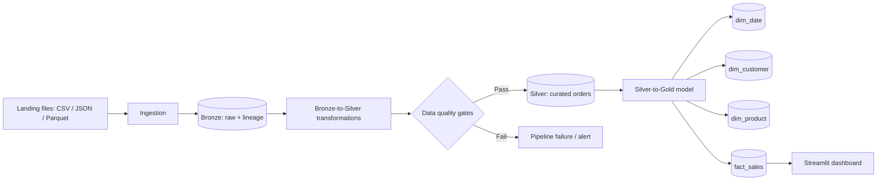

# Medallion Data Platform

A configurable batch analytics project that ingests source order files into Bronze, cleans them into Silver with PySpark, applies fail-fast data quality gates, models a Gold sales star schema, and presents Gold metrics in Streamlit.



## Setup

```powershell
python -m venv .venv
.\.venv\Scripts\Activate.ps1
pip install -e .
```

Place source data in `data/landing/orders` by default. Required fields are `order_id`, `customer_id`, `product_id`, `order_timestamp`, `quantity`, and `unit_price`; `discount_amount` is optional.

For a dashboard-only local demo when Spark cannot be started, use the bundled sample data:

```powershell
.\.venv\Scripts\python.exe scripts/create_demo_gold.py
```

## Run

```powershell
$env:SOURCE_PATH = "data/landing/orders"
python -m lakehouse_pipeline.pipeline --source-format csv
streamlit run src/dashboard/app.py
```

## Configuration

The pipeline reads these environment variables: `DATA_ROOT`, `SOURCE_PATH`, `BRONZE_PATH`, `SILVER_PATH`, `GOLD_PATH`, `CHECKPOINT_PATH`, `FILE_FORMAT` (`parquet` or `delta`), `WRITE_MODE` (`append` or `overwrite`), `PRIMARY_KEY`, and `EVENT_TIMESTAMP_COLUMN`.

## Data-quality gates

Before data is published, Silver must have a populated and unique `order_id` and non-negative `net_amount`. A failed gate raises `DataQualityError`, preventing writes to Silver and Gold.
